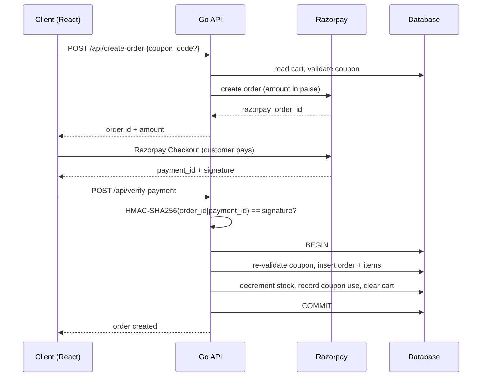
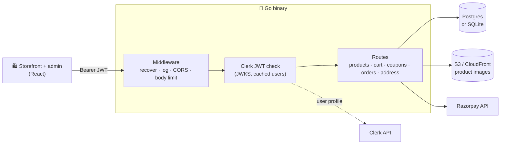

<div align="center">

# 🛍️ OLD.REPORT Backend (Go)

### A complete clothing-store API in one Go binary: products, cart, coupons, Razorpay checkout and orders.

Clerk handles sign-in, Razorpay takes the payment, and S3 hosts the product photos.<br>
Run it as a plain HTTP server, or deploy the **same binary** to **AWS Lambda** behind API Gateway.

[](https://go.dev)
[](https://clerk.com)
[](https://razorpay.com)
[](#%EF%B8%8F-configuration)
[](#-product-images)
[](#%EF%B8%8F-deploy)
[](https://github.com/Pranav-Conova/oldreport-backend-GO-/stargazers)

[**Quick start**](#-quick-start) · [**What it does**](#-what-it-does) · [**Checkout flow**](#-checkout-flow) · [**How it works**](#%EF%B8%8F-how-it-works) · [**API**](#-api) · [**Configuration**](#%EF%B8%8F-configuration) · [**Deploy**](#%EF%B8%8F-deploy)

</div>

---

## 🤔 Why?

OLD.REPORT is a clothing store (Men, Women and Kids; topwear and bottomwear). This repo is its backend API.

**The goal: one small, fast binary that runs anywhere.**

- 🪶 **Lean**: Go standard library `net/http` with no web framework. A handful of focused dependencies.
- 💳 **Real payments**: Razorpay orders, HMAC-verified payments, and stock decremented in the same database transaction that creates the order.
- 🔐 **No passwords to store**: users sign in with Clerk. The API verifies Clerk JWTs against Clerk's JWKS and syncs each user into its own table on first request.
- ☁️ **Server or serverless**: the same `http.Handler` runs as a normal server or on AWS Lambda, detected automatically at startup.
- 🧪 **SQLite for dev, Postgres for prod**: switch with one environment variable.

## ⚡ Quick start

**Prerequisites:** [Go 1.24+](https://go.dev/dl/), a [Clerk](https://clerk.com) application, and [Razorpay](https://razorpay.com) test keys.

```bash
git clone https://github.com/Pranav-Conova/oldreport-backend-GO-.git
cd oldreport-backend-GO-

cp .env.example .env    # fill in your Clerk and Razorpay keys
go run .
```

The API starts on **http://localhost:8080** with a local SQLite database (`test.db`). With `USE_S3=false` (as in `.env.example`) images are saved under `./media/`. Tables are created automatically.

```bash
curl http://localhost:8080/health
```

## ✨ What it does

| | Feature | Details |
|---|---|---|
| 👕 | **Products** | Name, description, price, category (`Men` / `Women` / `Kids`), subcategory (`Topwear` / `Bottomwear`), bestseller flag, and stock per size (`S`, `M`, `L`, `XL`). |
| 🖼️ | **Product images** | Multipart upload of one or more images, stored on S3 (optionally behind CloudFront) or on local disk. |
| 🙈 | **Soft delete** | Deleting a product hides it (`show=false`) instead of removing it, so past orders still reference it. |
| 🛒 | **Cart** | Per-user cart with add, update quantity and remove. |
| 🏷️ | **Coupons** | Flat or percentage discounts, with an optional cap, min/max order amount, total usage limit and per-user limit. Validated at checkout and again inside the payment transaction. |
| 💳 | **Razorpay checkout** | Create a Razorpay order from the cart, then verify the payment signature before anything is written. |
| 📦 | **Orders** | Customers see their own orders. Managers see every order and update delivery status and consignment number. |
| 🏠 | **Addresses** | One saved delivery address per user. |
| 👤 | **Roles** | Every user starts as `client`. Users with the `manager` role can manage products, coupons and all orders. |
| 🩺 | **Ops** | Request logging, panic recovery, a 32 MB body limit, strict CORS allow-list, and a `/health` endpoint that checks the database. |

## 💳 Checkout flow



Amounts are handled in **paise** internally, and the coupon is checked twice: once to show the discount, and again inside the transaction so a coupon can't be over-used between the two steps.

## ⚙️ How it works



1. **Middleware chain**: panic recovery → request logging → 404 tracing → CORS allow-list → 32 MB body limit.
2. **Auth**: `ClerkMiddleware` verifies the bearer token against Clerk's JWKS (refreshed in the background), fetches the user's profile from the Clerk API (cached for `CLERK_USER_CACHE_TTL_SECONDS`), and creates a row in `custom_users` if one doesn't exist.
3. **Data**: one repository layer speaks both SQLite (`modernc.org/sqlite`, pure Go, no CGO) and Postgres (`pgx`), rewriting query placeholders per dialect. On Lambda it prefers the Supabase transaction pooler URL.
4. **Runtime**: if `AWS_LAMBDA_FUNCTION_NAME` is set, the handler is wrapped with the API Gateway HTTP API (v2) adapter. Otherwise it starts an `http.Server` with sensible timeouts.

## 📡 API

Every endpoint except `/health` and reading products (`GET /api/products`, `GET /api/products/{id}`) expects `Authorization: Bearer <Clerk JWT>`. Most routes also answer without the `/api` prefix for backward compatibility.

<details open>
<summary><b>Products</b></summary>

| Method | Path | Access | Notes |
|---|---|---|---|
| `GET` | `/api/products` | public | Visible products only (`show=true`) |
| `GET` | `/api/products/{id}` | public | One product, including hidden ones |
| `POST` | `/api/products` | manager | `multipart/form-data`, see below |
| `PUT` | `/api/products/{id}` | manager | Replace stock details |
| `DELETE` | `/api/products/delete/{id}` | manager | Soft delete (`show=false`) |

Create a product with `multipart/form-data`: text fields `name`, `description`, `price`, `category`, `subcategory`, optional `bestseller` and `show`; `stock_details` as a JSON string such as `[{"size":"M","quantity":10}]`; and one or more `images` files.

</details>

<details>
<summary><b>Cart, address and profile</b></summary>

| Method | Path | Notes |
|---|---|---|
| `GET` | `/api/cart` | Current user's cart |
| `POST` | `/api/cart` | Add an item (JSON body) |
| `PUT` | `/api/cart` | Change an item's quantity |
| `DELETE` | `/api/cart` | Remove an item by `item_id` |
| `GET` / `POST` | `/address` | Read or create/update the saved address |
| `GET` | `/role` | `username`, `email` and `role` |
| `GET` | `/protected` | The Clerk user profile |

Invalid JSON bodies return `{"error": "Invalid JSON body."}`.

</details>

<details>
<summary><b>Coupons</b></summary>

| Method | Path | Access | Notes |
|---|---|---|---|
| `POST` | `/api/apply-coupon` | user | Returns `valid`, `discount_amount`, `final_total`, `message` |
| `GET` | `/api/coupons` | manager | List coupons |
| `POST` | `/api/coupons` | manager | Create a coupon |
| `GET` / `PUT` / `DELETE` | `/api/coupons/{id}` | manager | Read, update or delete |

Coupon fields: `code`, `discount_type` (`flat` or `percentage`), `discount_value`, `max_discount_cap`, `min_order_amount`, `max_order_amount`, `max_uses`, `max_uses_per_user` (0 = unlimited), `is_active`.

</details>

<details>
<summary><b>Orders and payments</b></summary>

| Method | Path | Access | Notes |
|---|---|---|---|
| `POST` | `/api/create-order` | user | Razorpay order from the cart, with optional `coupon_code` |
| `POST` | `/api/verify-payment` | user | Verify signature, create order, decrement stock, clear cart |
| `GET` | `/api/order-list` | user | Your orders |
| `GET` | `/api/all-orders` | manager | Every order |
| `PUT` | `/api/all-orders/{order_id}` | manager | Update `delivery_status` and `consignment_number` |

</details>

## 🖼️ Product images

| `USE_S3` | Where images go | URL |
|---|---|---|
| `true` | S3 bucket, key `media/product_images/*` | `AWS_S3_CUSTOM_DOMAIN` (e.g. CloudFront) if set, otherwise the bucket URL |
| `false` | `./media/product_images/` on disk | Served by the API at `/media/...` |

## ⚙️ Configuration

Settings come from environment variables or a `.env` file. See [`.env.example`](.env.example) for a full template.

| Variable | Default | Purpose |
|---|---|---|
| `CLERK_FRONTEND_API_URL` | *(required)* | Your Clerk frontend API, used to fetch the JWKS |
| `CLERK_SECRET_KEY` | *(required)* | Clerk backend key, used to fetch user profiles |
| `CLERK_API_URL` | `https://api.clerk.com/v1` | Clerk backend API base URL |
| `CLERK_USER_CACHE_TTL_SECONDS` | `300` | How long to cache Clerk profiles |
| `RAZORPAY_KEY_ID` / `RAZORPAY_KEY_SECRET` | *(required)* | Razorpay keys (`RAZOR_PAY_API_KEY` / `RAZOR_PAY_API_SECRET` also work) |
| `DB_BACKEND` | `sqlite` | `sqlite` for development, `postgres` for production |
| `SQLITE_PATH` | `test.db` | SQLite file when `DB_BACKEND=sqlite` |
| `DATABASE_URL` | | Postgres URL (or use `POSTGRES_HOST`, `_PORT`, `_USER`, `_PASSWORD`, `_DB`, `_SSLMODE`) |
| `SUPABASE_POOLER_URL` | | Postgres pooler URL preferred when running on Lambda |
| `USE_S3` | `true` | `true` uploads images to S3, `false` saves them to local disk |
| `AWS_STORAGE_BUCKET_NAME` / `AWS_S3_REGION_NAME` | | Required when `USE_S3=true` |
| `AWS_S3_CUSTOM_DOMAIN` | | CDN domain for image URLs |
| `CORS_ALLOWED_ORIGINS` | *(none)* | Comma-separated frontend origins. Empty blocks all cross-origin requests. |
| `PORT` | `8080` | HTTP port |
| `DEBUG` | `false` | Print stack traces for 404s (development only) |

## ☁️ Deploy

### Plain server

```bash
CGO_ENABLED=0 go build -trimpath -ldflags="-s -w" -o oldreport .
./oldreport
```

### AWS Lambda

`build-lambda.ps1` cross-compiles a static `bootstrap` binary and zips it:

```powershell
.\build-lambda.ps1               # linux/amd64
.\build-lambda.ps1 -Arch arm64   # Graviton
aws lambda update-function-code --function-name <your-function> --zip-file fileb://dist/lambda.zip
```

Use the `provided.al2023` runtime with an **API Gateway HTTP API** (payload format 2.0). No code changes are needed: the binary detects Lambda on startup.

## 🗂 Project structure

```text
oldreport-backend-GO-/
├── main.go              server, middleware chain, Lambda detection, /health
├── clerk_middleware.go  JWT verification (JWKS), Clerk profile cache, user sync
├── product.go           DB setup (SQLite/Postgres), schema, products, S3 uploads
├── cart_module.go       cart endpoints
├── coupon_module.go     coupon CRUD, validation and apply-coupon
├── order_module.go      Razorpay orders, payment verification, order lists
├── api_module.go        /role and /address
├── lambda_handler.go    API Gateway v2 adapter
├── env_loader.go        minimal .env loader
└── build-lambda.ps1     Lambda build + zip script
```

## 🧰 Built with

- [Go](https://go.dev) `net/http`, [pgx](https://github.com/jackc/pgx), [modernc.org/sqlite](https://gitlab.com/cznic/sqlite)
- [Clerk](https://clerk.com) with [golang-jwt](https://github.com/golang-jwt/jwt) and [keyfunc](https://github.com/MicahParks/keyfunc)
- [Razorpay](https://razorpay.com), [AWS SDK for Go v2](https://github.com/aws/aws-sdk-go-v2) (S3), [aws-lambda-go](https://github.com/aws/aws-lambda-go)

---

<div align="center">

If this helped you build your own store backend, a ⭐ helps other people find it.

</div>
